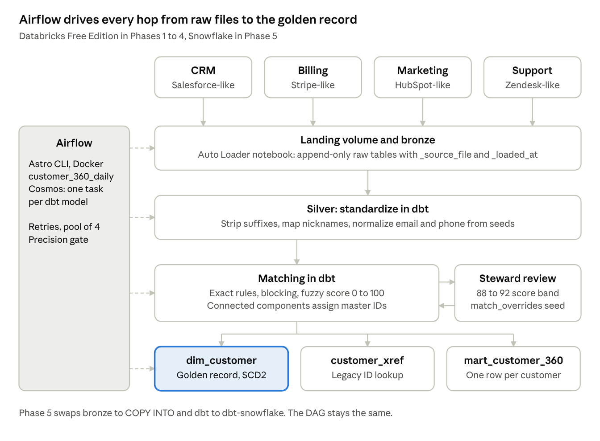

# Emily: MDM Project Plan

Oct 28, 2026 · @Chris

## Overview

Over the next 16 weeks (Nov 2, 2026 to Feb 21, 2027) you build one Customer 360 project with entity resolution, dbt and Airflow.

## The project: Customer 360 golden record

You build a dim_customer that resolves one real customer across four source systems, plus a cross-reference table that maps every legacy ID back to one master ID.

**The business problem you'll pitch in interviews.** Sales knows the customer as "Acme Corp" in the CRM. Billing has "ACME Corporation" under a different ID. Marketing has three leads with two email spellings. Support has a ticket from a personal Gmail. Finance can't answer "what is this customer worth to us" and a CCPA deletion request takes a person a week of manual hunting. One golden record fixes both.

**In scope:** person and company matching, deterministic and fuzzy rules, survivorship, a steward review queue, a Customer 360 mart, Airflow orchestration, and a Snowflake port.

**Out of scope for now:** CI/CD with GitHub Actions, ML-based matching, real-time streaming, and a front-end app. Each one goes in the README's future enhancements section.

### Sources

I wrote the generator for you; the code is in the **Generator code** tab of this doc. It builds 7,000 true customers (15% are marketing-only prospects) and renders each one into four systems the way those tools actually store people. Every source record lands in an answer key with its true_customer_id, so you can measure precision and recall on your matches. That number is your best interview line.

**The story in the numbers.** A billing migration on Mar 1, 2025 re-created customers instead of mapping them. 228 customers now have two Stripe IDs with their revenue split across both, and Enterprise accounts got hit hardest. Your golden record is what puts that revenue back together.

| System | Folder | Mimics | Rows in batch 0 | Mess baked in |
| --- | --- | --- | --- | --- |
| CRM | `crm/contacts` | Salesforce contacts | 5,313 | Nicknames (Bill for William), suffix drift ("Corp" vs "Corporation"), 8% duplicate contacts, half of them under a duplicate account |
| Billing | `billing/customers, billing/invoices` | Stripe customers and invoices | 4,207 customers, 74,428 invoices | Shared AP inboxes (ap@), remit-to PO boxes, epoch timestamps, migration duplicates |
| Marketing | `marketing/leads, marketing/touches` | HubSpot contacts and events | 7,665 leads, 23,542 touches | Up to 3 leads per person, Gmail dots and +tags, .con typos, 25% missing company |
| Support | `support/requesters, support/tickets` | Zendesk users and tickets | 2,360 requesters, 5,549 tickets | One name field ("Todd, Denise", "d. todd"), same person writing from work and personal inboxes |
| Answer key | `_answer_key/answer_key` | Ground truth | 19,545 | None. Use it only to score matches |

Stretch goal from our May session: load the CRM slice into a free Salesforce Developer Edition org and pull it through the API instead of a file. Do it only after Phase 4 is green.

### Running the generator

Same seed and start date give identical rows on both platforms, so your Databricks and Snowflake golden records should match to the row.

|  | Databricks (Phases 1 to 4) | Snowflake (Phase 5) |
| --- | --- | --- |
| File | `databricks_land_batch.py`, imported as a notebook | `snowflake_land_batch.py`, run from your laptop |
| Needs | `c360_generator.py` in the same Git folder | `pip install "faker>=28,<40" "snowflake-connector-python>=3.12"` |
| Lands in | `/Volumes/c360/landing/raw/<system>/<entity>/batch_date=YYYY-MM-DD/` | `@C360.LANDING.RAW_STAGE/<system>/<entity>/batch_date=YYYY-MM-DD/` |
| Your next step | Auto Loader into bronze | `COPY INTO` into bronze |

**Batch 0** is the full history up to Nov 2, 2026. Run it once.

**Batch N** holds only what happened on Nov 2 plus N days: new customers, CRM edits, new invoices, leads, touches and tickets. In Phase 4, Airflow passes batch as a notebook parameter computed from the run date.

**Reruns are safe.** The same batch rewrites the same file with the same rows, so a cleared Airflow task can't double-load.

If Free Edition won't let you create the c360 catalog, set the notebook's catalog widget to workspace.

Before you touch either platform, run `python c360_generator.py --out ./landing --batch 0` on your laptop and open the CSVs in VS Code. Ten minutes reading the mess will shape your standardization rules more than any blog post.

### Stack

| Layer | Tool | Why this choice |
| --- | --- | --- |
| Compute and storage | Databricks Free Edition, Unity Catalog | $0, and you already know it from the real estate project |
| Landing and bronze | Unity Catalog volume, Auto Loader notebook | Files in, append-only raw tables with load metadata |
| Silver and gold | dbt Core with `dbt-databricks` | The skill 13 of 20 postings asked for; ports to dbt-snowflake in Phase 5 |
| Matching | dbt SQL models plus one dbt Python model | Blocking and scoring in SQL, connected components in Python |
| Orchestration | Apache Airflow via Astro CLI, Astronomer Cosmos | Runs locally in Docker; Cosmos turns each dbt model into an Airflow task |
| Version control | GitHub, one repo, main and dev branches | Same pull, commit, push habit from September |

### Architecture

Customer 360 architecture · 4 sources, 5 layers, 1 DAG

Dashed arrows are Airflow tasks. Everything from silver down is a dbt model, which is why the Snowflake port is mostly a profile change.

## Build plan

Six phases, each ending in something you can demo. Don't start a phase until the previous one passes its "done when" line.

### How the matching works

This is the core of the project and the part interviewers will push on. Build it in this order:

1. **Standardize (silver).** Lowercase and trim everything. Strip legal suffixes (Inc, LLC, Corp) from a `company_suffixes` seed. Map nicknames (Bill to William) from a `nicknames` seed. Lowercase emails and drop Gmail dots and `+tags`. Reduce phones to digits, then E.164.

2. **Deterministic matches.** Exact normalized email, exact phone plus last name, exact company domain. Score 100, no review needed.

3. **Blocking.** Only compare records that share a block key: `soundex(last_name)` plus ZIP3, or the first four characters of the normalized company. Without blocking, 20,000 records means 200 million pairs and your Free Edition quota dies by lunch.

4. **Fuzzy scoring.** Weighted 0 to 100 score across name, company, address and phone similarity. Wrap the similarity function in a dbt macro with adapter.dispatch: `levenshtein()` on Databricks, `JAROWINKLER_SIMILARITY()` on Snowflake. Same model, two platforms.

5. **Thresholds.** 93 and up auto-matches, 88 to 92 goes to the review queue, under 88 stays separate. Tune the bands against your precision and recall numbers, then write down why you landed where you did.

6. **Clustering.** One dbt Python model runs connected components (networkx) over accepted pairs, so A matches B and B matches C puts all three under one master ID.

7. **Survivorship.** Rules live in a   `survivorship_rules` seed, one row per attribute. Name: most frequent, ties go to most recent (remember the "Ilium" vs "William" case). Email: CRM beats marketing. Address: most recent billing address. Phone: most complete.

8. **Steward overrides.** A `match_overrides` seed with `force_match` and `force_split` rows. The next run honors them. This is your answer to "what happens when the algorithm is wrong?"

### Phase 1: Foundation and sources (weeks 1 to 3)

- ✅  GitHub repo with `generator/`, `dbt/`, `airflow/` folders and a README stub

- 🔲 Land batch 0 with the provided generator and keep the `true_customer_id` answer key out of bronze

- ✅ Unity Catalog: `c360` catalog with `landing`, `bronze`, `silver`, `gold` schemas and a landing volume (`landing_dev.raw`)

- 🔲 Auto Loader notebook loads bronze with `_source_file` and `_loaded_at` columns

- 🔲 dbt project connected to the Free Edition SQL warehouse; `sources.yml` with freshness checks

- 🔲 One staging model per source, unique and not_null tests on every source key

**Done when:** dbt build runs green from your laptop against four bronze tables.

### Phase 2: Standardize and match (weeks 4 to 6)

☐ Steps 1 to 5 above as dbt models: `int_customer_standardized`, `int_match_candidates`, `int_match_scores`

☐ Similarity macro with `adapter.dispatch` and a unit test on five known pairs (dbt unit tests)

☐ `match_evaluation` model that joins to the answer key and reports precision, recall and F1

**Done when:** you can say "precision X, recall Y at threshold 93" and explain one false positive. Suggested target: precision 0.95, recall 0.90.

### Phase 3: Golden record and dimensional model (weeks 7 to 9)

☐ Clustering Python model and generated master IDs (`MC_` prefix, never a source system's ID)

☐ `customer_xref`: master ID, source system, source ID, match rule, match score. One row per source record, so a new system adds rows, never columns

☐ `dim_customer` golden record from the survivorship seed, with an SCD2 dbt snapshot on top

☐ `match_review_queue` for the 88 to 92 band, plus the overrides seed wired in

☐ Facts at their natural grain: `fct_invoices`, `fct_support_tickets`, `fct_marketing_touches`, all keyed to master ID

☐ `mart_customer_360`: one row per customer with lifetime revenue, open tickets, last marketing touch

**Done when:** you can pick any customer and trace every source record and dollar back to them. Weeks 8 and 9 run over the holidays, so this phase has slack built in.

### Phase 4: Airflow orchestration (weeks 10 and 11)

☐ Astro CLI project running Airflow locally in Docker; Databricks connection stored in Airflow, not the repo

☐ DAG `customer_360_daily`: generate batch, land files, run the bronze job (`DatabricksRunNowOperator`), dbt build as a Cosmos task group, quality gate, notify

☐ Retries with exponential backoff, `max_active_runs=1`, and an Airflow pool of 4 slots (Free Edition caps you at 5 concurrent job tasks)

☐ Quality gate task fails the run if precision drops below your Phase 2 number

☐ Backfill three days of batches and show the master IDs stay stable when a new record joins an existing cluster

**Done when:** you can kill a task mid-run, clear it, and the rerun produces identical gold tables.

### Phase 5: Snowflake port (weeks 12 to 14)

☐ Start the 30-day trial on Jan 18, 2027, and don't add a credit card. Set a resource monitor anyway; it's exam material

☐ Roles `C360_LOADER`, `C360_TRANSFORMER`, `C360_ANALYST` and one warehouse per workload with 60-second auto-suspend

☐ Internal stage, file format and `COPY INTO` for bronze, then a Task that runs it on a schedule

☐ Swap the dbt target to `dbt-snowflake` and fix whatever the dispatch macros missed

☐ Rebuild customer_xref incrementally with a Stream plus a Task; build `mart_customer_360` once as a Dynamic Table and compare

☐ Masking policy on email and phone for `C360_ANALYST`

☐ Zero-copy clone a dev database; drop a table and bring it back with Time Travel

☐ Run the scoring model on an X-Small and a Small warehouse and read both Query Profiles

☐ Point the same Airflow DAG at Snowflake with a second Cosmos profile

**Done when:** one DAG, two targets, same golden record counts on both.

### Phase 6: Portfolio (weeks 15 and 16)

☐ README with every decision point: option picked, options rejected, why (same format as the real estate repo)

☐ Architecture diagram and a precision/recall chart in the README

☐ Future enhancements: CI/CD with GitHub Actions and DABs, ML matching, streaming CDC, a steward app

☐ Mock interview walk-through with me, pitched to a non-technical hiring manager first, then a senior DE
